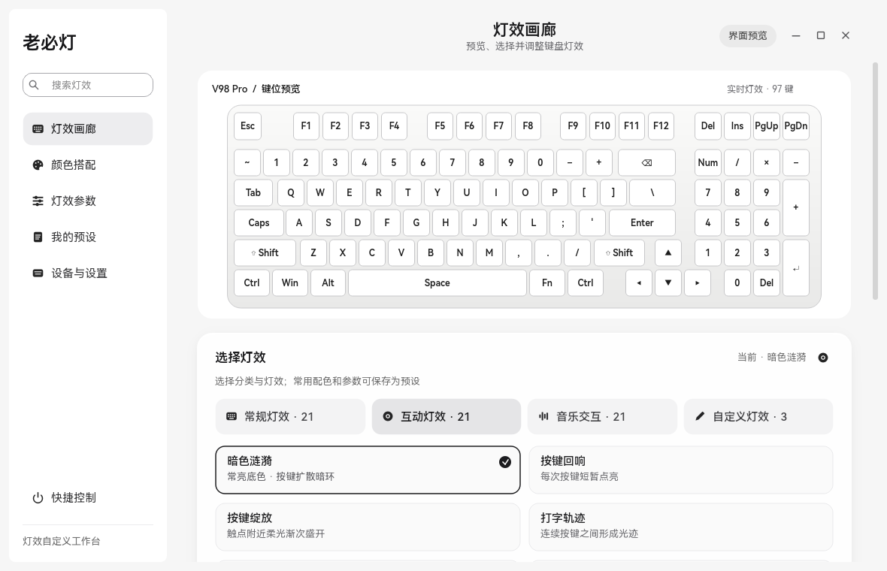
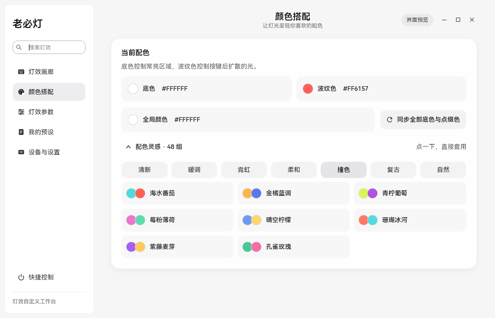
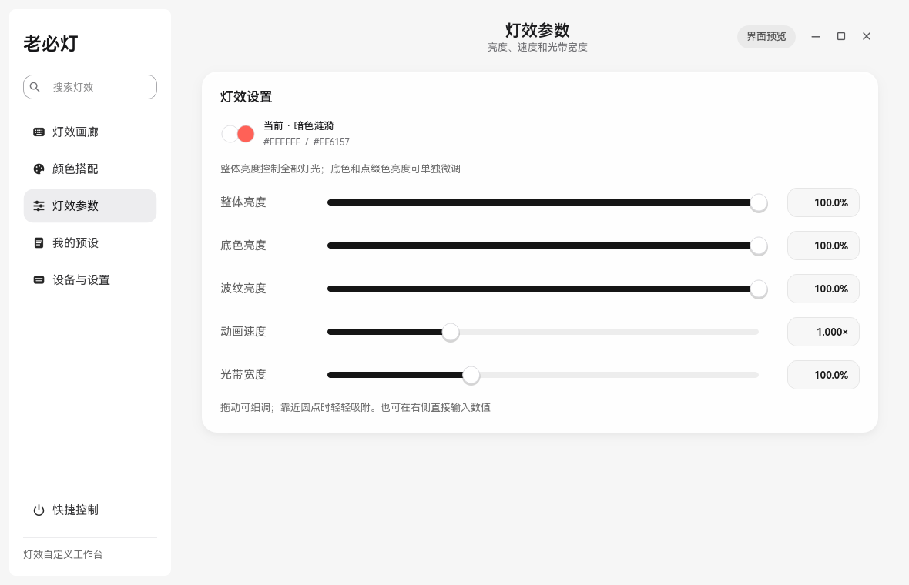
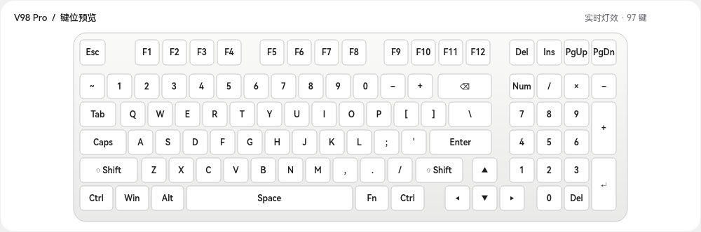
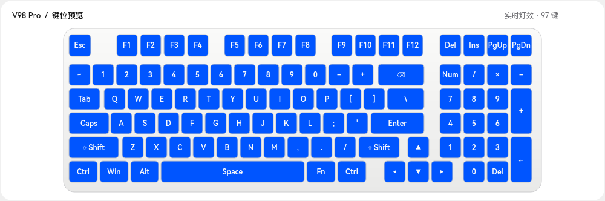
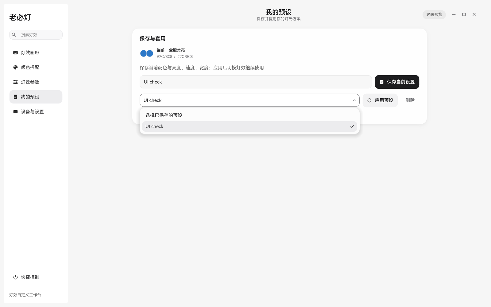

# 运行与界面检查记录

## v1.5.10 全屏按键兼容

- 用户报告三角洲全屏时互动失效，切回桌面立即恢复。现有日志显示互动期间灯光线程持续完成帧，旧日志仅有接收线程存活状态，不能证明当时收到按键；进一步只读检查进程令牌：本机三角洲为 elevated=True，老必灯为 elevated=False，确认存在权限差异；权限隔离与现象相符，但尚未据此断言反作弊的内部行为。
- 保留独立线程 Raw Input，增加同一线程 15ms 原生定时器的 GetAsyncKeyState 高位状态采样；两路合并、长按去重、漏抬起恢复。仅互动灯效运行，无游戏注入或输入拦截。日志只加累计次数和末次事件年龄，不写按键内容。
- `tools/check_game_input.py` 19 项通过：后台原始消息缺失、采样与原始消息先后顺序、快速连按、长按、组合键、丢失抬起、小键盘 Enter、原生线程定时器、启停，以及兼容事件到完整灯光帧的集成路径。使用合成 API 状态和假 HID，不等于三角洲实机认证。
- 增加显式的本次管理员重启入口，Windows UAC 同意后保存并交接；新实例在日志、锁、HID 初始化前等待旧实例完全退出。取消授权不退出旧实例，不修改自启或安全策略。`tools/check_game_restart.py` 12 项通过（模拟授权返回值和真实等待子进程），没有在测试中弹出 UAC。
- 45 项输入 / 托盘、22 项独立灯流、87 项 UI 检查通过。UI 测试的固定 240ms 等待在本机两次未等到滑块收敛，改为最多 1.2 秒等待实际到达同一端点，断言不变；未改变滑块产品代码。
- 限制：采样不能保证捕获短于采样间隔的瞬时按键；仅有异步状态时无法区分共享虚拟键码的物理键位，优先采用 Raw Input。Windows 权限隔离、受保护桌面和游戏输入限制仍需现场验证，不能据受控测试宣称已全部兼容。
- 系统接口依据：[GetAsyncKeyState](https://learn.microsoft.com/en-us/windows/win32/api/winuser/nf-winuser-getasynckeystate)。只使用当前按下高位，不采用不可靠的低位事件标记。

## v1.5.9 缩放与连续灯效

- 直接发现：旧版由界面 QTimer 执行动画计算及 USB 同步写入；模拟界面 700ms 无回调时，没有新完整帧发出。界面停顿超过 8 秒还会无条件重连。圆角区域更新同时同步阴影并再次排队同步，所有页面卡片也参与尺寸调整。
- 改动：独立线程计算动画、消费输入并发送 USB / 2.4G 帧；工作线程私有动画历史与句柄，音频采样、刷新及释放在同一线程。界面读取已发送帧和发送心跳，健康灯流不因界面停顿重连。原生缩放期间暂停分层阴影，松手恢复；合并阴影更新，仅排版可见页面，减少强制重绘。
- `tools/check_resize_stream.py` 使用假 HID 验证：700ms 无界面回调时继续完成 21–22 帧；模拟 10 秒界面间隔后保持原连接；原生进入 / 离开缩放消息正确暂停及恢复阴影。72 次相同尺寸序列，旧版中位数 20.54ms / P95 26.22ms，首次新版普通调整 13.91ms / 16.65ms，暂停阴影后的另次读数 12.38ms / 14.74ms。读数为本机受控负载，非屏幕帧率承诺。
- `tools/check_stream_lifecycle.py`：22 项假 HID / 音频检查通过，覆盖独立输出、暂停恢复、互动、音频线程归属、完整无线报告及间隔、错误传递、句柄只关闭一次和新连接不复用旧句柄。模拟拔出会产生预期异常日志。
- 原有 87 项 UI、45 项输入 / 托盘、14 项音频检查通过；UI 检查覆盖 100% / 150% 缩放。静态画面已查看；鼠标自动化只触发了 21ms 的短缩放，未据此判断持续拖动手感。持续输出依据上述阻塞模拟与线程检查，不声称已覆盖所有真实机器与驱动。

## v1.5.8 输入与托盘修复

- 互动灯效从界面线程低级键盘钩子改为独立 Windows 消息线程的 Raw Input 后台接收。使用 `RIDEV_INPUTSINK | RIDEV_DEVNOTIFY`，不使用屏蔽输入的标志。设备拔出清理状态；长按去重；归一化修饰键、小键盘与 Pause；停止时销毁消息窗口并注销接收，意外退出每两秒重试。灯效事件队列有容量上限且不阻塞接收线程。
- 托盘右键菜单采用 18px 圆角浮层、柔和外影、12px 操作行、统一图标及悬停 / 按压反馈。Esc、点击外部、窗口失焦、原生前台切换及托盘宿主隐藏 / 移动均收起菜单。隐藏后停止轮询，执行操作前先释放弹出菜单。
- `tools/check_input_tray.py`：45 项检查在 100% / 150% 下通过，覆盖按键归一化、长按、多个设备、拔出清理、四次原生注册 / 停止、队列上限、菜单状态与键盘操作、失焦和宿主变化收起、工作区边缘及文字宽度。未连接 HID 灯控，未改写用户设置。
- `tools/check_ui.py`：原有 87 项界面检查在 100% / 150% 下通过。
- 实际桌面同时运行两个独立进程的 Raw Input 接收器，两者接收到相同的 21 次输入事件；未记录按键内容。该检查验证了同时接收与后台消息路径，不等于所有游戏、反作弊环境或受保护桌面的兼容认证。
- 新版安装包已构建；更早版本的性能采样仅保留为历史记录，不代表本次重新测量。

## v1.5.7 视觉与性能基线

以用户提供的 Apple / Marvis 参考、HarmonyOS Sans SC 字体和现有中性配色为依据。Awwwards、Webby Awards、FWA 用作完成度要求，不代表任何奖项认证；桌面工作台优先保证操作清晰与反馈稳定。

| 检查维度 | 本次完成 |
| --- | --- |
| 排版 | 完整字体随包加载；正文、标题、说明字级统一；修复按钮文字空间不足、键位标签裁切。 |
| 留白 | 合并画廊标题与当前灯效；卡片间距保持，组内排版收紧；小窗口减少预览空白高度。 |
| 视觉层级 | 参数和预设页显示当前灯效与双色摘要；选色入口紧接色盘；主要操作和次要操作层级统一。 |
| 色彩 | 保留软件浅中性配色，RGB 用于灯光内容；修正低功率底色在屏幕上变成近黑色的问题，白、蓝、青色保持所选颜色；零输出显示中性灰。 |
| 动效 | 按钮悬停、按压、选择使用局部缓动；开关及快捷面板有方向明确的运动；关闭系统动画时立即响应。缓存键位文字布局与色彩计算，预览按变化刷新，动画与设备输出分离。 |
| 微交互 | 单圈焦点和选中态；按压高光；滑块跟随指针、释放吸附且禁用滚轮；Esc 关闭快捷控制；选色取消恢复；预设浮层支持方向键、Enter、Esc 和外点关闭。 |
| 响应式 | 分类、配色风格和样本自动换行；弹窗内容滚动，保存操作固定；检查 880×600、960×650、1180×760、1600×1000 逻辑窗口。 |
| 原创性 | 统一自绘图标、按钮和下拉控件；键盘灯色、逐键绘制、灯效定位和方案摘要构成工作台自身的操作语言。 |

## 验证范围

- `tools/check_ui.py`：87 项检查在 100% 和 150% 显示缩放下通过。涵盖五个页面、字体、布局、滑块、长键完整显示、自定义键盘操作、选色恢复、无效 HEX、全局颜色、通用预设、空搜索和快捷控制；检查低功率白、蓝、青色的实际键面像素、设备帧不被预览修改、混色边界连续性，以及预设浮层的提交、取消与左右边缘对齐。
- 新增原生圆角区域、内外圆角关系、曲线边缘对角缩放、输入穿透阴影、最小化 / 最大化 / 还原 / 托盘状态、无变化帧不重画、按需音频依赖，以及隐藏启动后实际窗口恢复的检查。
- `tools/check_audio_performance.py`：13 项流式滤波数值等价检查通过，覆盖随机音频、不同块长度、连续状态和五种频率；误差容限为相对 1e-10 / 绝对 1e-12。另检查切换效果时不会等待后台清理。2048 点计算实测约 4–5 倍加速，此数字仅代表滤波步骤。
- 自绘下拉的单独检查覆盖 100% / 150%：选择信号只发送一次、数据角色、方向键 / End / Enter / Esc / Space、鼠标选择、外点关闭、长列表滚动、屏幕边界、禁用与空列表。预设、设备和模板选择均使用相同控件。
- 两种弹窗检查了 1280×800、1024×576、640×480 可用逻辑视区，验证选择、改名、按键绑定、删除、模板恢复和 Esc。
- 安装包成功构建，打包程序日志确认加载 HarmonyOS Sans SC 全部字重和实际应用字体；新增图标文件存在。
- 本机安装后程序已启动，现有设置文件哈希保持不变，USB 键盘与播放设备重新连接。
- 硬件协议、输出频率、灯效图案和键位映射未修改；音乐滤波改为等价向量计算。检查期间预览模式不向设备发送灯光帧，不改写用户设置。

窗口实际轮廓扩大为 32px，侧栏采用 20px / 12px 留白的同心关系。主体保持不透明；独立阴影层输入穿透，使用缓存九宫格且不绘制中心。原生窗口区域在尺寸事件中同步更新。已通过 Windows Graphics Capture 检查实际外侧阴影、圆角与内容层；原先无法取得外侧截图的限制已解除。长时间、多显卡、多屏幕及其他机器的表现不包含在本次验证范围中。

## 运行开销

本机短时采样：旧程序私有内存约 446MB，新程序初次音乐运行约 78MB，实际显示内容后约 98MB。旧程序前台约占一个核心的 71%，新版短时采样约 39%。这些是本机运行读数，会受声音、可见页面、窗口状态、缓存和其他进程影响，不作为所有机器的性能承诺。后台预览刷新停止，设备灯光仍继续输出；分析库在音乐工作线程按需加载，BLAS 限制为单线程。

## 上一版基线截图

以下为 v1.5.6 的独立预览检查画面，弱光帧经显示映射还原所选颜色；不表示硬件的物理亮度测量。

